# Uwazi Admin Agent

## A web UI for bulk Uwazi administration

Write a task. Review the plan. Run it. Revert it.

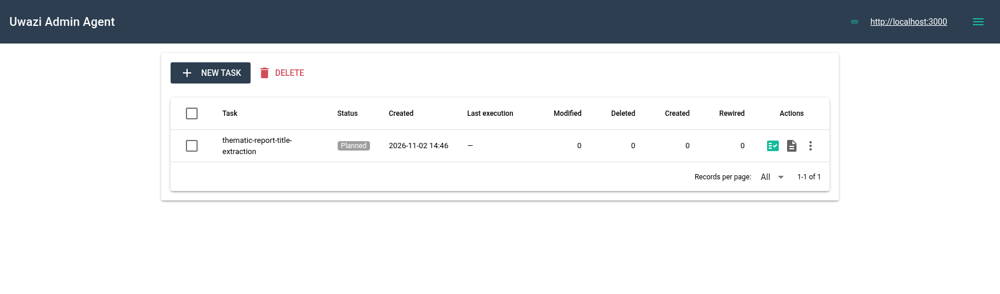

---
layout: default
---

# A web UI for Uwazi admin work

  

    
1

    <h3>Connect</h3>
  

  

    
2

    <h3>Describe</h3>
  

  

    
3

    <h3>Review &amp; run</h3>
  

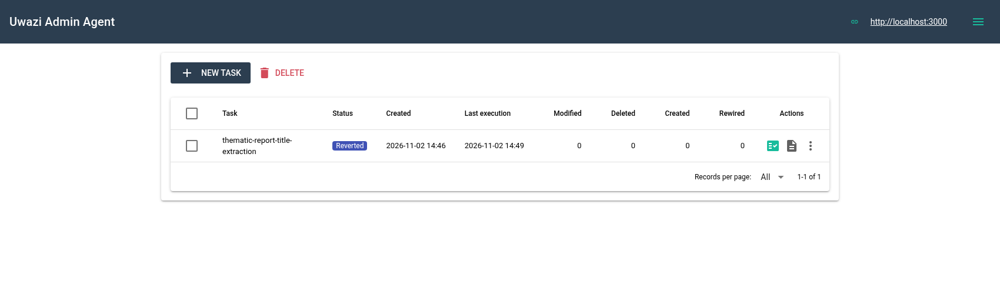

---
layout: default
---

# How it works

  

    
✍️

    
Prompt

  

  
→

  

    
🧠

    
Plan

  

  
→

  

    
🔍

    
Review

  

  
→

  

    
✅

    
Run / Revert

  

The LLM proposes. You approve.

---
layout: default
---

# What it can do

✏️<strong>Metadata</strong>

🔀<strong>Merge entities</strong>

📎<strong>Files</strong>

➕<strong>Create entities</strong>

🗑️<strong>Delete / publish</strong>

🔗<strong>Relationships</strong>

🌍<strong>Languages</strong>

📊<strong>Table sync</strong>

---
layout: default
---

# AI reads documents

  <figure>
    
  </figure>
  

- **Titles**
- **Dates**
- **Summaries**
- **Classifications**

Page 1 in. A proposed value out.

  

---
layout: section
---

# Example

## Title extraction from page 1

---
layout: none
---

  
1 New task

  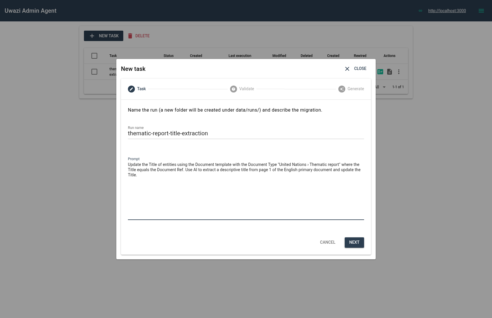

---
layout: none
---

  
2 Review table

  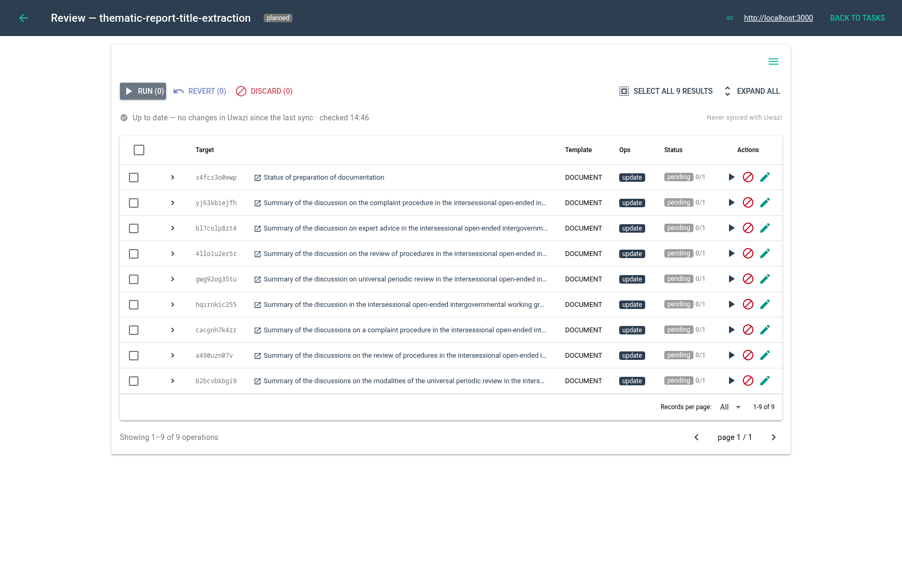

---
layout: none
---

  
2 Inspect the proposal

  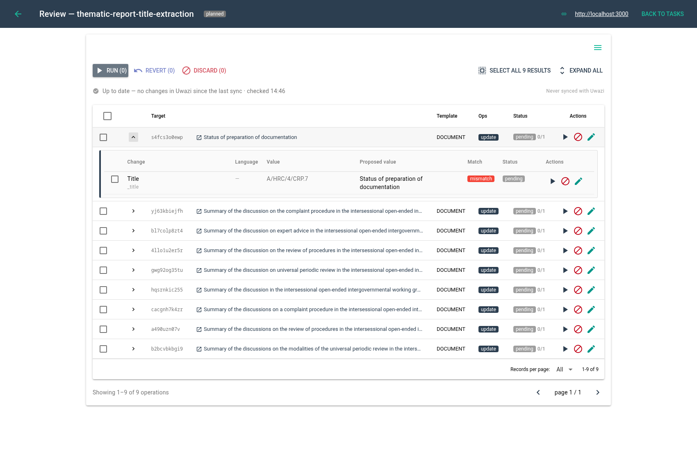

---
layout: none
---

  
2 AI reads page 1

  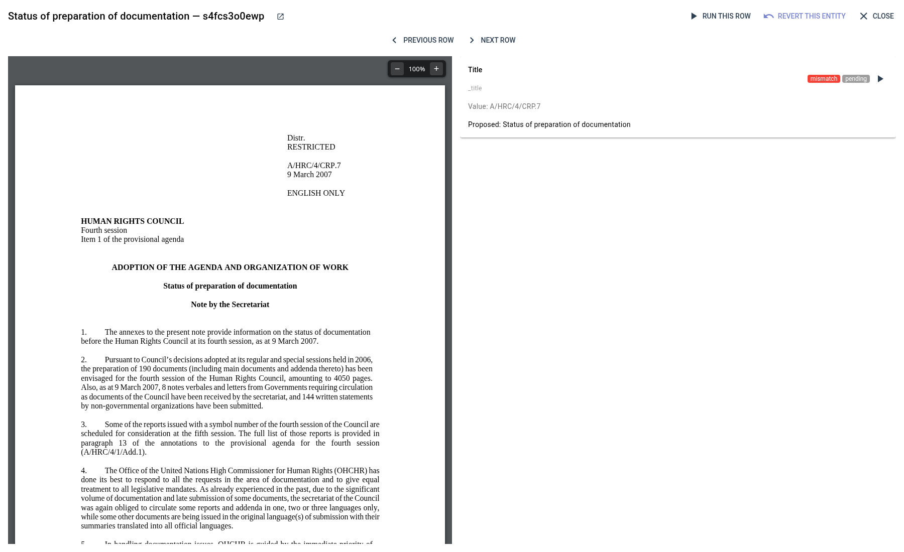

---
layout: none
---

  
3 Run

  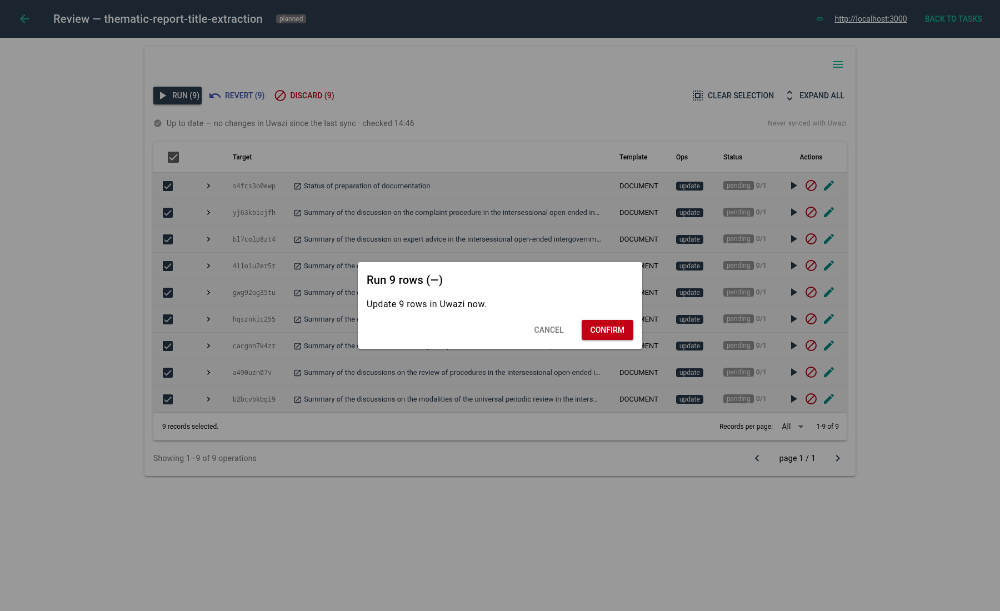

---
layout: none
---

  
3 Applied

  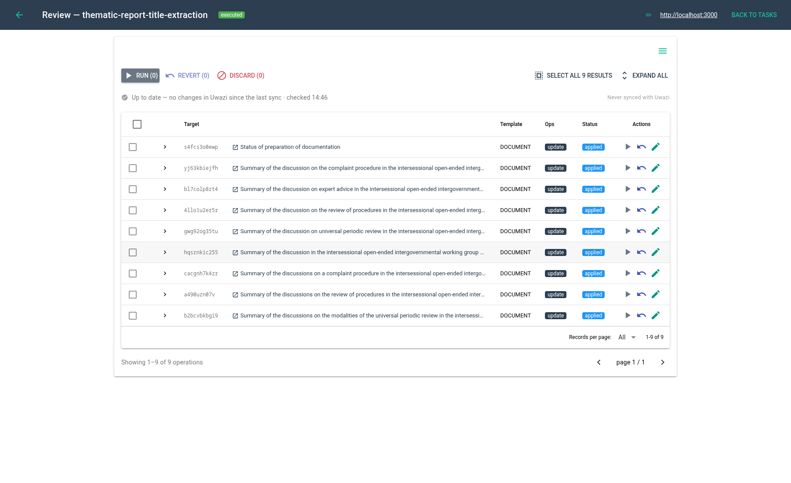

---
layout: none
---

  
3 Result in Uwazi

  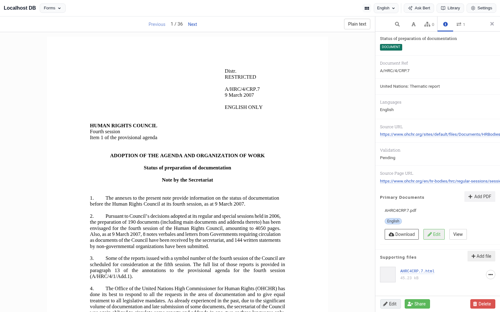

---
layout: none
---

  
4 Revert

  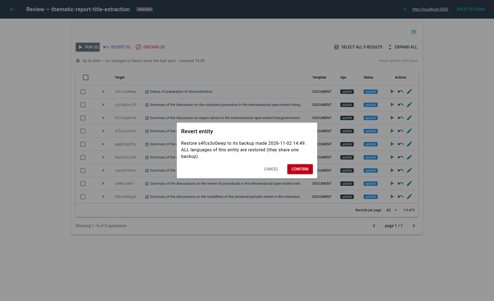

---
layout: none
---

  
4 Reverted

  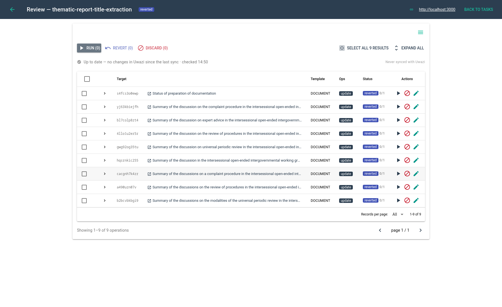

---
layout: none
---

  
4 Back to the original

  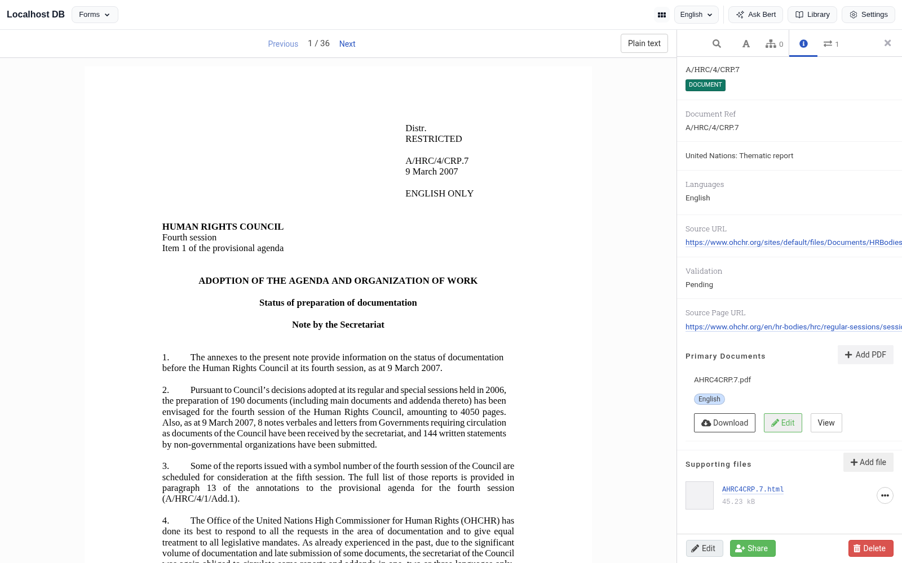

---
layout: outro
---

# Write. Review. Run. Revert.

A web UI for Uwazi admin work.

